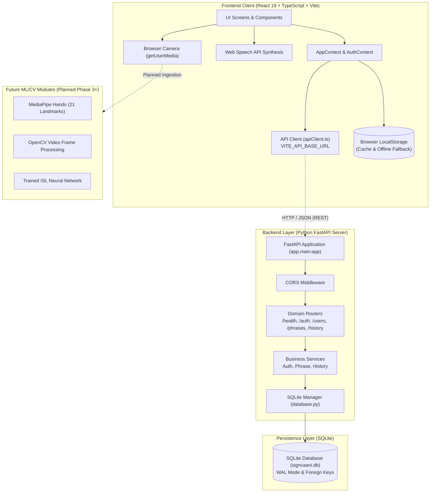

# SignVaani System Architecture

---

## 1. High-Level Architectural Diagram

---

## 2. Architectural Layers

### A. Frontend Layer (React 19 + TypeScript + Vite)
- **Framework**: React 19 single-page application built with Vite and Tailwind CSS v4.
- **Routing & State**: Internal state-driven AppShell navigation (`AppNavigator`), `AppContext`, `AuthContext`, and `ThemeContext`.
- **Media Hardware**: HTML5 `<video>` element with WebRTC `navigator.mediaDevices.getUserMedia()` for webcam preview.
- **Speech Output**: Browser-native Web Speech API (`window.speechSynthesis`) with voice selection and language classification.
- **Offline / Local Fallback**: Standard browser `localStorage` acts as a zero-latency local cache and automatic offline fallback.

### B. Centralized Frontend API Service Layer (`src/services/apiClient.ts`)
- Configured via environment variable `VITE_API_BASE_URL` (default: `http://127.0.0.1:8000/api`).
- Configurable `AbortController` timeout (2.5 seconds) ensuring network hangs never freeze the user interface.
- Gracefully detects backend availability and reports status to services.
- Never throws unhandled network errors directly into React components.

### C. Backend Layer (Python FastAPI)
- **Server**: FastAPI with Uvicorn ASGI server running at `http://127.0.0.1:8000`.
- **CORS**: Configured for local development origins (`http://localhost:5173`, `http://127.0.0.1:5173`, etc.).
- **Lifespan Initialization**: Non-destructive schema initialization (`init_db()`) and demo account seeding on server startup.
- **Routers**: Grouped modularly under `/api`:
  - `/api/health`
  - `/api/auth`
  - `/api/users`
  - `/api/phrases`
  - `/api/history`

### D. Persistence Layer (SQLite)
- **Database Engine**: Python standard library `sqlite3` connecting to `signvaani.db`.
- **Connection Parameters**: `check_same_thread=False`, `PRAGMA foreign_keys = ON`, `PRAGMA journal_mode = WAL`.
- **Tables**:
  1. `users`: Stores user credentials, hashed passwords, speech settings, and UI preferences.
  2. `saved_phrases`: Stores multilingual saved phrases linked by user email.
  3. `history_items`: Stores logs of spoken communications, translations, confidence scores, and timestamps.

---

## 3. Security & Password Hashing Architecture

- **Algorithm**: PBKDF2-HMAC-SHA256 with 100,000 iterations.
- **Salt Generation**: 16-byte cryptographically secure pseudorandom salt (`secrets.token_hex(16)`).
- **Storage Format**: `salt$hash` stored in the `password_hash` column.
- **Verification**: Constant-time HMAC comparison via `hmac.compare_digest` to prevent timing attacks.
- **Protection**: Plaintext passwords are never persisted to the database and never logged.

---

## 4. LocalStorage & Offline-First Strategy

1. **Immediate Local Availability**: On application launch, the frontend reads immediately from `localStorage` so the UI renders with zero network delay.
2. **Asynchronous Background Synchronization**: When the backend is online, `AppContext` fetches the latest remote phrases and history in the background, updating the local cache.
3. **Graceful Fallback**: When the backend server is offline or unreachable, all user mutations (saving phrases, deleting records, logging history) succeed locally without blocking or displaying misleading errors.
4. **Non-Destructive Operations**: Remote synchronization merges with or updates local cache without deleting existing user data.
